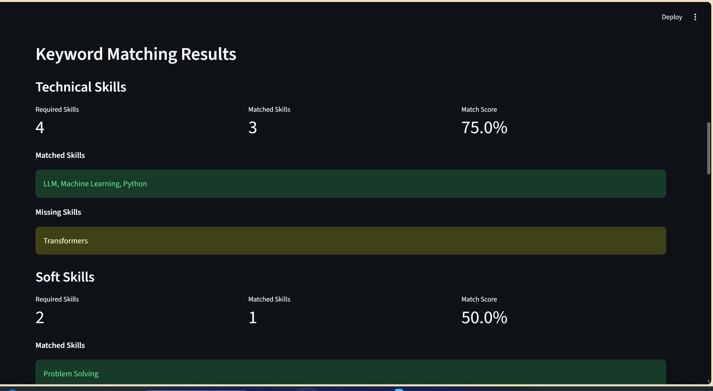
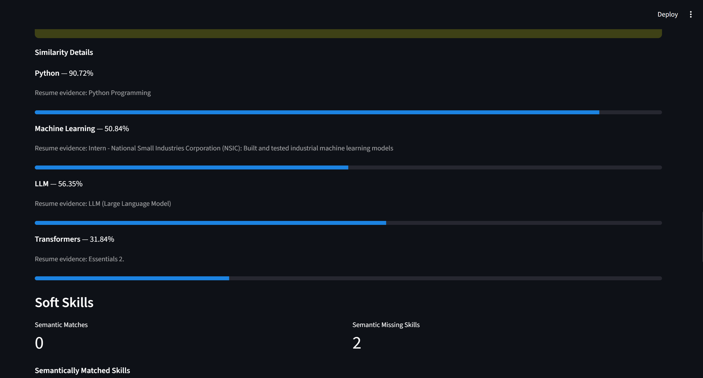
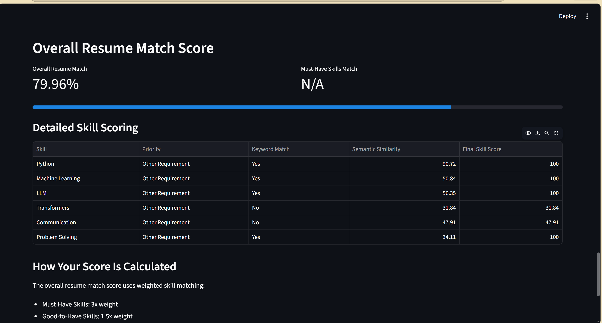

# AI Resume Analyzer

AI Resume Analyzer is a Streamlit app that compares a PDF resume with a job description. It shows which skills appear in both, highlights missing keywords, and surfaces resume excerpts that are semantically similar to the job's recognized skills.

## How it Works and Demo

Upload a text-based PDF resume and paste a job description into the Streamlit app. When you click Analyze Resume, the app extracts text from the PDF and identifies skills in both inputs using its built-in skill list. If the job description includes “Must have skills” or “Good to have skills” headings, the app uses them to classify recognized requirements.

<br>



<br>

The app first compares keywords and shows which skills match or are missing. It then uses the all-MiniLM-L6-v2 model to compare each recognized job skill with sections of the resume. The results show a similarity percentage and the resume excerpt that most closely matches each skill.

<br>


<br>

The app calculates an overall match score by giving exact keyword matches 100 points and using semantic similarity for the remaining skills. Must-have skills carry 3× weight, good-to-have skills carry 1.5×, and other recognized skills carry 1×. The results include a per-skill breakdown so you can see how each skill contributed to the final score.



## Run locally

Use Python 3.10 (the version used to verify this project). From the project folder in PowerShell, run:

```powershell
python -m venv .venv
.\.venv\Scripts\python.exe -m pip install -r requirements.txt
.\.venv\Scripts\python.exe -m streamlit run app.py
```

Open the local URL printed by Streamlit. Upload a text-based PDF, paste a job description, and select **Analyze Resume**. The first semantic analysis requires internet access to download the `all-MiniLM-L6-v2` model. Once the model is cached, comparisons run locally.

## How scoring works

The app extracts recognized skills from the job description and checks for keyword matches in the resume. Sentence Transformers and cosine similarity compare each recognized skill against chunks of resume text and show the best-matching excerpt. A similarity of at least 50% is displayed as a semantic match.

The overall score is a weighted average. A keyword match earns 100 points. Otherwise, the app uses the semantic similarity percentage, with a minimum of zero. The 50% display threshold does not affect this calculation.

| Skill priority | Weight |
| --- | ---: |
| Must-have | 3× |
| Good-to-have | 1.5× |
| Other recognized job skill | 1× |

The app relies on its built-in skill vocabulary and PDF text extraction. Scanned PDFs without a text layer need OCR first. The score measures skill-text alignment and excludes education and experience requirements. It is neither an official ATS score nor a hiring prediction.

## Project files

| File | Purpose |
| --- | --- |
| `app.py` | Streamlit interface and PDF text extraction with PyMuPDF |
| `skill_extractor.py` | Skill extraction, requirement classification, and keyword matching |
| `semantic_matcher.py` | Resume chunk embeddings, similarity scores, and matching excerpts |
| `score_calculator.py` | Weighted overall and must-have skill scores |

## About This Project

I built AI Resume Analyzer to explore how keyword matching and language models can help someone review a resume against a specific job description. The project brings together PDF text extraction, skill matching, and a Streamlit interface. The detailed results let users trace the overall score back to individual skills and see which parts of the resume the model found most relevant.
